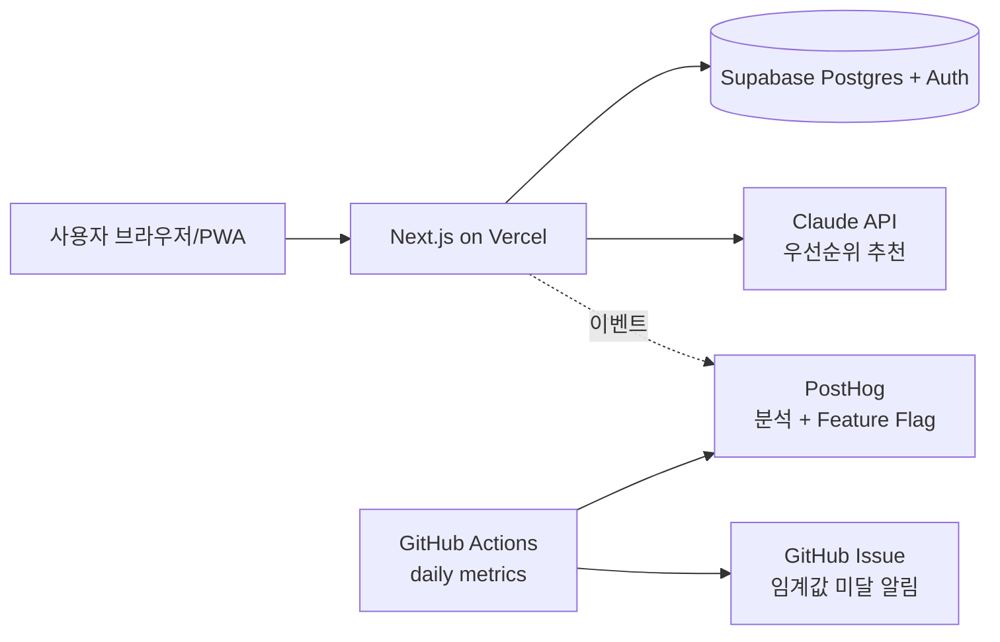

<!--
변경 이력
- 2026-11-26 (김지호): "공개 웹 데이터 수집·파싱 제품" 도메인용 카탈로그(§2.2 끝)와 "지금 하지 않을 것" 후보(§2.3 끝)를 추가했다.
  배경: 학교 공지 크롤링 + 마감일 추출 제품(NotiCatch)의 PRD를 쓰려는데 기존 카탈로그가 웹앱(Next.js, Supabase) 위주여서
  수집기·파서·스케줄러·캘린더 선택지와 수집 제품 고유의 확인 사항(robots.txt, 요청 간격)이 빠져 있었다.
- 이 변경 이전의 내용은 수정하지 않았다.
-->

# 팀 구성과 기술 스택 — "실행 가능한 수준"의 기준

07-team.md와 08-tech-stack.md를 쓸 때 읽으세요. 핵심 원칙 하나: **MVP 단계의 팀과 스택은 "최종 제품"이 아니라 "다음 실험"을 위해 고른다.**

---

## Part 1. 팀 구성

### 1.1 MVP 단계 역할 카탈로그

| 역할 | MVP 단계 책임 | 전형적 FTE | 대체 가능 수단 |
|---|---|---|---|
| 제품/PM (창업자 겸임이 보통) | 가설 정의, 인터뷰, 지표 리뷰 주관, Pivot 제안 | 0.5~1.0 | 대체 불가 — 이 역할이 없으면 BML이 안 돌아감 |
| 풀스택/프론트엔드 | MVP 구현, 분석 이벤트 심기, Feature Flag | 0.8~1.0 | No-code(Softr, Bubble), BaaS 템플릿 |
| 백엔드 | API, 데이터 모델, 인증, 배치 | 0~0.5 (MS0~MS1은 보통 0) | Supabase/Firebase/PocketBase 등 BaaS |
| 디자인 | 온보딩 플로우, 랜딩 페이지 | 0.2~0.3 | Tailwind UI/shadcn 템플릿, Figma 커뮤니티 |
| 데이터/분석 | 이벤트 설계, 코호트 분석, 대시보드 | 0.1~0.2 | PostHog/Amplitude 내장 리포트, GitHub Actions 메트릭 스크립트 |
| 그로스/마케팅 | 얼리어답터 유입, 채널 실험 | 0.2 (MS2 이후) | 창업자가 직접 커뮤니티 활동 |
| 도메인 전문가 | 규제·업무 지식 검증 | 자문 (시간당) | 인터뷰 대상자 중 한 명을 자문으로 |

### 1.2 마일스톤별 팀 성장 패턴 (전형)

```
MS0 문제 검증       : PM 1 (풀타임 아니어도 됨). 코드 없음. 인터뷰·랜딩 페이지.
MS1 솔루션 검증 MVP : PM 1 + 풀스택 1. BaaS로 백엔드 대체.
MS2 리텐션 검증     : + 디자인 0.3 (온보딩 개선), + 분석 0.2.
MS3 성장 엔진 검증  : + 그로스 0.2, 백엔드 분리 검토 시 BE 0.5.
```

"처음부터 5명"은 린스타트업의 반대입니다. 팀이 커지는 조건을 마일스톤 종료 조건과 연결하세요 ("MS1 통과 시 디자이너 합류").

### 1.3 역할 표 작성 예

| 역할 | 책임 | 필요 역량 | 투입 | 담당 마일스톤 | 충원 상태 |
|---|---|---|---|---|---|
| PM / 창업자 | 가설·지표 정의, 주 10건 인터뷰, 격주 지표 리뷰 | 사용자 인터뷰, Lean Canvas, SQL 기초(PostHog HogQL) | 1.0 | MS0~MS3 | 본인 |
| 풀스택 | Next.js 앱, Supabase 스키마/RLS, PostHog 이벤트, Feature Flag | TypeScript, React 18+, Postgres, Vercel 배포 | 0.8 | MS1~MS3 | 본인 (MS0 종료 후 착수) |
| 디자인 | 온보딩 3화면, 랜딩 페이지 | Figma, Tailwind | 0.3 | MS2 | 외주 (MS1 통과 시, 예산 50만 원) |

### 1.4 의사결정 규칙에 꼭 들어갈 것

- **지표 리뷰 주기**: 격주 금요일, 30분. 입력은 05의 지표 표 최신값.
- **Pivot/Persevere 제안 주체와 결정 방식**: PM 제안 → 전원 합의, 불일치 시 10-risks-and-pivot.md §2의 숫자 트리거가 우선.
- **범위 추가 규칙**: 새 기능은 반드시 가설 ID가 붙어야 백로그에 들어감 (가설 없는 기능 = 낭비).
- **실험 WIP 제한**: 동시에 돌리는 실험 최대 2개 (강의 Section 08 Projects 보드).

---

## Part 2. 기술 스택

### 2.1 선택 원칙

1. **2주 안에 첫 사용자에게 도달할 수 있는가?** 이것이 1순위. 확장성은 MS2 이후 문제.
2. **분석 이벤트를 심기 쉬운가?** Measure가 안 되는 스택은 린스타트업에 맞지 않음.
3. **Feature Flag로 10% 사용자에게만 노출할 수 있는가?** (강의 Section 08)
4. **팀이 이미 아는 것인가?** 새 기술 학습은 실험 속도를 떨어뜨림. "배우고 싶어서"는 MVP 단계의 근거가 아님.
5. **무료 또는 종량제로 시작 가능한가?** 고정비는 Pivot 시 매몰 비용.

### 2.2 계층별 선택지 카탈로그

아래는 **출발점**입니다. 가격·한도는 바뀌므로 공식 pricing 페이지에서 확인하고 URL·확인일을 PRD에 남기세요. (여기 적힌 요금 메모는 작성 시점 참고용이며 검증 대상입니다.)

**프론트엔드 (웹)**

| 선택지 | MVP 적합 상황 | 주의 |
|---|---|---|
| Next.js (React) + Tailwind + shadcn/ui | 랜딩+앱을 한 저장소에, Vercel 배포 1분 | 팀이 React를 모르면 학습 비용 |
| SvelteKit | 적은 코드량, 빠른 프로토타입 | 생태계·외주 인력 풀이 작음 |
| Vite + React SPA | 백엔드가 따로 있고 SEO 불필요 | 랜딩 페이지 SEO 약함 |
| No-code (Softr, Glide, Bubble) | MS0~MS1에서 코드 없이 Wizard of Oz | MS2에서 재작성 가능성, 이벤트 트래킹 제약 |

**모바일**

| 선택지 | MVP 적합 상황 | 주의 |
|---|---|---|
| PWA (웹앱 홈화면 추가) | 앱스토어 없이 모바일 검증. **MVP 기본 권장** | 푸시 알림 iOS 제약 |
| Expo (React Native) | 네이티브 기능(카메라, 푸시) 필수 | 스토어 심사 기간(1~2주)이 사이클을 늦춤 |
| Flutter | 팀이 Dart에 익숙 | 웹 분석 도구 연동 수고 |

**백엔드 / 데이터 / 인증**

| 선택지 | MVP 적합 상황 | 주의 |
|---|---|---|
| Supabase (Postgres + Auth + Storage + Edge Functions) | 관계형 데이터, SQL로 코호트 분석, BE 인력 0 | RLS 정책 설계 필요 |
| Firebase (Firestore + Auth) | 실시간 동기화, 모바일 | NoSQL이라 집계·코호트 쿼리 불리 |
| PocketBase | 단일 바이너리, 셀프호스팅 | 커뮤니티 규모 작음 |
| FastAPI / NestJS 자체 구현 | AI 파이프라인, 복잡한 도메인 로직 | BE 0.5 FTE 이상 필요 — MS0~MS1에서는 과함 |

**AI / LLM (AI 기능이 핵심 가설일 때)**

| 선택지 | MVP 적합 상황 | 주의 |
|---|---|---|
| 호스팅 API (Anthropic Claude, OpenAI, Google Gemini) | 프롬프트만으로 MS1 검증 | 토큰 비용 상한 설정, 응답 캐싱 |
| 오픈소스 모델 (Ollama, vLLM) | 데이터 외부 전송 불가, 비용 민감 | GPU 인프라 — MVP 단계에서는 보통 과함 |
| **Wizard of Oz** (사람이 뒤에서 답함) | "AI가 추천하면 사용자가 따를까?"를 **모델 없이** 검증 | 10~30명 규모까지만 운영 가능 |

**호스팅 / 배포**

| 선택지 | 적합 | 주의 |
|---|---|---|
| Vercel / Netlify | Next.js·정적 사이트, Preview 배포 | 서버리스 실행 시간 한도 |
| Cloudflare Pages + Workers | 저비용·글로벌 | Node 호환성 일부 제약 |
| Railway / Render / Fly.io | 컨테이너·DB 한 번에 | 무료 한도 변동 잦음 |

**분석 · 실험 · Feature Flag** (강의 Section 05·07·08과 직결)

| 선택지 | 역할 | 비고 |
|---|---|---|
| PostHog | 이벤트 분석 + 코호트 + Feature Flag + A/B 테스트 + 세션 리플레이 **한 도구** | MVP 기본 권장. 오픈소스(셀프호스팅 가능) |
| Amplitude / Mixpanel | 제품 분석 특화 (강의 참고 자료) | Feature Flag는 별도 |
| LaunchDarkly / Unleash(OSS) / Flagsmith(OSS) | Feature Flag 전용 | PostHog로 충분하면 불필요 |
| GA4 | 랜딩 페이지 유입 분석 | 제품 내 이벤트 분석에는 부적합 |
| GitHub Actions + 스크립트 | 일일 지표 수집, 임계값 미달 시 Issue 생성 (강의 Section 08) | 과제 3과 연결 |

**공개 웹 데이터 수집·파싱 제품 (게시판·공지·가격·채용 공고를 모아 가공하는 제품)** — 2026-11-26 추가

| 계층 | 선택지 | MVP 적합 상황 | 주의 |
|---|---|---|---|
| 수집 | requests + BeautifulSoup | 정적 HTML 게시판, 이미 Python을 앎 | 자바스크립트로 렌더링되는 페이지는 못 읽음 |
| 수집 (동적) | Playwright | 렌더링 후 DOM이 필요한 사이트 | 실행 시간·메모리가 큼. 대상의 20% 이상일 때만 |
| 수집 (공식 경로) | RSS / 공식 API / 공개 데이터 포털 | 있으면 항상 먼저 | 필드가 제한적일 수 있음 |
| 추출·파싱 | 정규식 규칙 + 정답 코퍼스 테스트 | 표기 형식이 유한하고 오류를 숫자로 재야 함 | 규칙이 늘면 서로 충돌. 코퍼스 없이 늘리면 회귀를 못 잡음 |
| 추출·파싱 (보조) | LLM 후보 추출 + 규칙 검증 | 규칙으로 정확도 임계값을 못 넘길 때 | 호출 비용 상한을 먼저 정할 것, 결과를 사실로 단정하지 않는 화면 필요 |
| 주기 실행 | GitHub Actions cron | 서버 없이 30분~1일 주기 | 최소 주기와 월 실행 시간 한도, cron 지연 |
| 결과 전달 | `.ics` 구독 피드 | 캘린더 앱의 링크 구독을 쓰면 연동 승인이 필요 없음 | 반영 지연(앱마다 수 시간) |

수집 제품에서 반드시 확인할 것: 대상 사이트의 `robots.txt`와 이용약관, 요청 간격(예: 사이트당 분당 N회 이하), 개인정보(작성자 이름·연락처)를 저장하지 않는지. 이것은 리스크 레지스터(10)에도 올린다.

**CI/CD**

| 선택지 | 비고 |
|---|---|
| GitHub Actions | 테스트 + `validate_prd.py` + 배포. 기본 |
| Vercel Git 연동 | PR마다 Preview URL — 사용자 테스트에 유용 |

### 2.3 "지금 하지 않을 것" 목록 — 전형적 후보

MVP 단계에서 **의식적으로 미루는** 것을 적고, 다시 검토할 조건을 붙입니다.

| 하지 않을 것 | 다시 검토할 조건 |
|---|---|
| 마이크로서비스 / Kubernetes | MAU 10만 또는 팀 8명 이상 |
| 자체 인증 구현 | BaaS 인증으로 불가능한 규제 요구가 생길 때 |
| 네이티브 앱 (스토어) | PWA에서 D30 리텐션 30% 이상 확인 후 |
| 다국어 | 국내 세그먼트 PMF 후 |
| 정교한 권한/역할 시스템 | B2B 세그먼트 Pivot 시 |
| 데이터 웨어하우스 | PostHog 내장 분석으로 답 못 하는 질문이 3개 이상 쌓일 때 |
| 모델 파인튜닝 | 프롬프트+RAG로 MS2 종료 조건 미달 시 |
| 사이트 로그인이 필요한 영역 수집 | 사이트 운영자 허락을 받거나 공식 API가 생길 때 (2026-11-26 추가) |
| 수집 결과 원문 전체 저장·재배포 | 링크와 발췌만 쓰는 것으로 충분한지 약관 확인 후 (2026-11-26 추가) |

### 2.4 아키텍처 다이어그램 예 (Mermaid)



### 2.5 ADR 한 줄 형식

큰 결정(예: BaaS vs 자체 백엔드)은 표 밖에 ADR(Architecture Decision Record) 한 블록을 둡니다.

```
### ADR-1: 백엔드는 MS0~MS1 동안 Supabase
- 상황: BE 인력 0, 2주 내 인증+CRUD 필요, 코호트 분석용 SQL 필요
- 결정: Supabase. FastAPI는 MS2에서 AI 파이프라인이 복잡해지면 분리
- 결과: BE 채용 MS2까지 연기. RLS 정책 학습 비용 2일 감수
- 되돌릴 조건: Edge Function 실행 시간 한도 초과가 주 1회 이상
```
