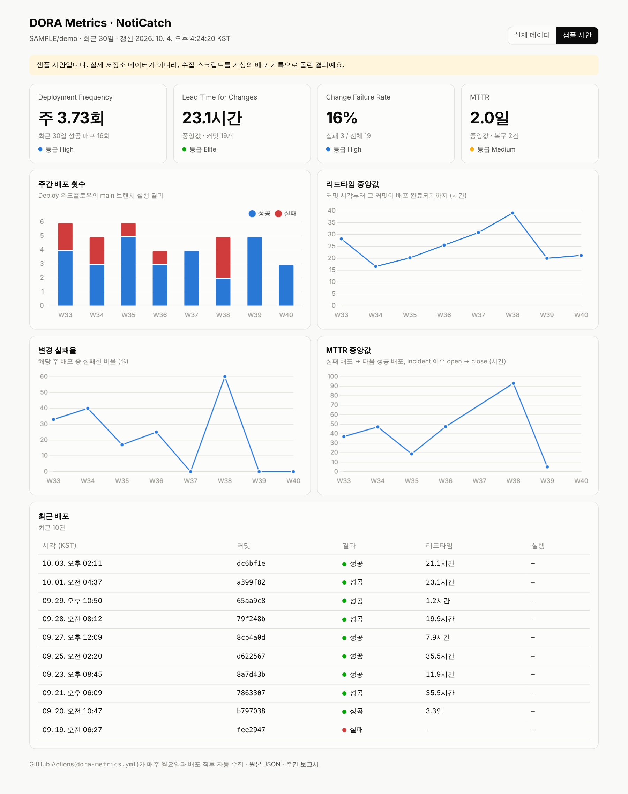
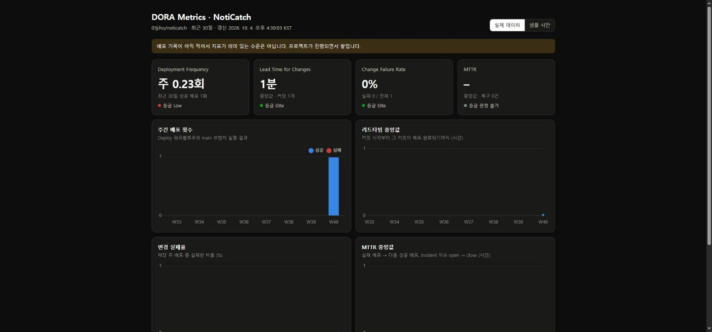
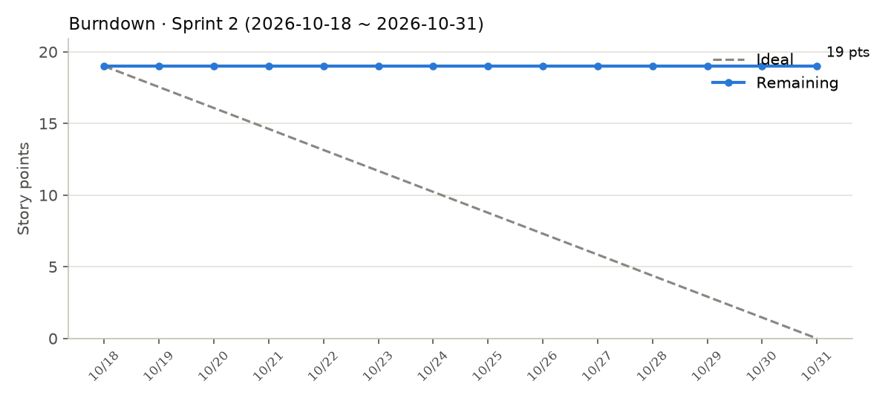
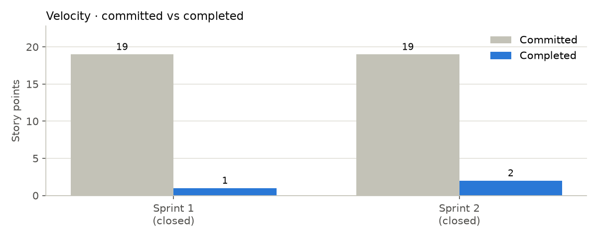

#  NotiCatch - 놓치는 학교 공지가 없도록

> 흩어진 학교 공지를 한곳에 모으고, 내가 구독한 키워드가 들어간 공지만 골라 알려주는 오픈소스 서비스

| 항목 | 내용 |
|---|---|
| 과목 | OSS기반SW프로그래밍 |
| 작성자 | 김지호 (2243577) · [@03jiho](https://github.com/03jiho) |
| 라이선스 | MIT |
| 상태 | 설계·협업 체계 구축 중 (6주차 기준, 기능 구현 전) |

---

## 1. 문제 정의

### 누가, 언제, 무엇 때문에 불편한가

- **누가:** 재학생, 특히 장학금·수강신청·교환학생·채용 정보를 챙겨야 하는 학생
- **언제:** 마감이 있는 공지가 올라왔는데, 그 공지를 며칠 뒤에야(또는 마감 후에) 알게 될 때
- **왜:** 공지가 **학교 홈페이지, 단과대·학과 게시판, LMS, 학생지원 사이트** 등 여러 곳에 흩어져 있어서, 매일 모든 사이트를 직접 확인하지 않으면 놓치기 쉽다.

### 기존 방법의 한계

| 기존 방법 | 한계 |
|---|---|
| 각 사이트 직접 방문 | 매일 여러 곳을 확인해야 하고, 대부분은 나와 상관없는 공지 |
| 학교 앱 / 카톡 채널 | 전체 공지를 다 보내거나, 일부 게시판만 다룸 → 알림 피로 |
| 친구·단톡방 전달 | 운에 의존, 늦게 전달됨 |

### 사용자 검증 계획

- 2~3주차에 재학생 **5명 이상 인터뷰**와 간단한 설문(Google Form)을 진행한다.
  - 질문 예: "최근 한 학기 동안 마감을 놓친 공지가 있었나?", "공지를 주로 어디서 확인하나?", "어떤 키워드를 받고 싶나?"
- 결과를 `docs/user-research.md`에 정리하고, 기능 우선순위에 반영한다.

---

## 2. 핵심 기능 (3개)

### ① 통합 공지 수집 (플러그인형 크롤러)
- 여러 게시판의 공지를 주기적으로 수집해서 **한 화면 타임라인**으로 보여준다.
- 게시판마다 크롤러를 **플러그인 파일 하나**로 분리한다.
  → 다른 학과·학교 학생도 `crawlers/` 폴더에 파일 하나만 추가하면 기여할 수 있다. *(OSS 기여 구조)*

### ② 키워드 구독 & 알림
- 사용자가 `장학`, `근로`, `교환학생`, `인턴` 같은 키워드와 관심 게시판을 등록한다.
- 키워드에 맞는 새 공지가 올라오면 **이메일 / 웹 푸시**로 바로 알린다.
- 제외 키워드(예: `대학원`)를 지원해서 알림 피로를 줄인다.

### ③ 마감일 추출 & 캘린더 연동
- 공지 본문에서 신청 기간과 마감일을 자동으로 추출한다(정규식 → 추후 개선).
- 구독한 공지의 마감일을 **.ics 캘린더 구독 링크**로 제공한다 → Google·Apple 캘린더에 자동 반영된다.
- 마감 D-3, D-1 리마인드 알림을 보낸다.

---

## 3. 기술 스택

| 영역 | 기술 | 선택 이유 |
|---|---|---|
| 크롤러 | Python, requests, BeautifulSoup | 게시판 HTML 파싱에 가볍고 익숙함 |
| 백엔드 API | FastAPI | 빠른 개발, 자동 API 문서(Swagger) |
| DB | SQLite → PostgreSQL | 개발은 간단하게, 배포 시 확장 |
| 스케줄링 | GitHub Actions (cron) / APScheduler | 서버 없이 주기 크롤링 가능 |
| 프론트엔드 | Next.js (TypeScript) | 기존 개발 경험 활용, Vercel 배포 |
| 알림 | 이메일(SMTP), Web Push | 별도 앱 설치 없이 알림 |
| 협업·품질 | GitHub Issues/Projects, PR 리뷰, pytest, GitHub Actions CI | OSS 개발 프로세스 실습 |

---

## 4. 시스템 구조 (초안)

```
[학교 홈페이지] [학과 게시판] [LMS] ...
        │  (crawlers/ 플러그인)
        ▼
  수집기 (GitHub Actions cron, 30분 간격)
        │
        ▼
  DB (공지 · 사용자 · 구독 키워드)
        │
  ┌─────┴──────────┐
  ▼                ▼
FastAPI          알림 매처 ──▶ 이메일 / 웹 푸시
  │                └────────▶ .ics 캘린더 피드
  ▼
Next.js 웹 (타임라인 · 구독 설정)
```

---

## 5. 16주 마일스톤 (초안)

| 주차 | 단계 | 목표 / 산출물 |
|---|---|---|
| 1 | 환경 설정 | Git/GitHub·SSH 설정, 저장소 생성, 프로젝트 제안서(본 문서) |
| 2 | 사용자 조사 | 인터뷰·설문 진행, 대상 게시판 목록과 크롤링 가능 여부(robots.txt) 확인 |
| 3 | 요구사항 | 사용자 스토리, GitHub Issues·Projects 보드 구성, 라이선스·CONTRIBUTING.md |
| 4 | 설계 | DB 스키마, API 명세, 크롤러 플러그인 인터페이스 정의 |
| 5 | 크롤러 v1 | 게시판 2곳 크롤러 + 중복 제거 + 단위 테스트 |
| 6 | 백엔드 v1 | FastAPI 공지 조회 API, GitHub Actions 주기 수집 |
| 7 | 프론트 v1 | Next.js 통합 공지 타임라인, 검색 |
| 8 | **중간 점검** | MVP 데모(기능 ①), 중간 발표 |
| 9 | 구독 | 회원(이메일) 등록, 키워드·제외 키워드·게시판 구독 |
| 10 | 알림 | 키워드 매칭 → 이메일 알림, 알림 로그 |
| 11 | 웹 푸시 | Web Push 알림, 알림 설정 화면 |
| 12 | 마감일 | 마감일 추출, .ics 캘린더 피드, D-1·D-3 리마인드 |
| 13 | 확장·기여 | 크롤러 5곳 이상으로 확장, 외부 기여 가이드·이슈 템플릿 |
| 14 | 사용자 테스트 | 재학생 베타 테스트(5명 이상), 피드백 반영 |
| 15 | 안정화 | 버그 수정, 테스트 커버리지, 문서화, 배포 |
| 16 | **최종 발표** | 최종 데모, 회고, v1.0 릴리스 태그 |

> 2학기로 이어서 진행한다면: 다른 학교 플러그인 지원, 공지 요약(LLM), 모바일 PWA를 추가할 계획이다.

---

## 6. 오픈소스 운영 계획

- **라이선스:** MIT
- **기여 방법:** `CONTRIBUTING.md`에 크롤러 플러그인 추가 방법을 단계별로 안내하고, `good first issue` 라벨을 운영한다.
- **브랜치 전략:** `main`(배포) / `feat/*` → PR → 리뷰 후 병합
- **윤리·법적 고려:** robots.txt와 이용약관을 준수하고, 요청 간격을 제한하며, 공지는 원문 링크 중심으로 제공한다(본문 전체 재배포 X).

---

## 7. 1주차 개발 환경 설정 기록

- [x] GitHub 계정 확인 (`03jiho`)
- [x] 저장소 생성 (MIT 라이선스) 및 제안서 첫 커밋
- [x] Git 설치 및 사용자 정보 설정 (`git config --global user.name / user.email`)
- [x] SSH 키 생성(ed25519) 및 GitHub 등록, `ssh -T git@github.com` 인증 확인
- [x] SSH로 clone → 로컬 커밋 & 푸시

---

## 8. 2주차: DORA 메트릭 자동 수집

GitHub Actions로 DORA 4대 지표를 자동으로 모으고, 대시보드와 주간 보고서로 보여준다.

- **대시보드:** https://03jiho.github.io/noticatch/ (샘플 시안: [`?demo=1`](https://03jiho.github.io/noticatch/?demo=1))
- **최신 주간 보고서:** [`reports/LATEST.md`](reports/LATEST.md) · **원본 JSON:** [`metrics/dora-latest.json`](metrics/dora-latest.json)

### 구성

| 파일 | 역할 |
|---|---|
| [`.github/workflows/deploy-pages.yml`](.github/workflows/deploy-pages.yml) | `main`에 push되면 대시보드를 GitHub Pages로 배포. DORA에서 말하는 "배포"의 기준 |
| [`.github/workflows/dora-metrics.yml`](.github/workflows/dora-metrics.yml) | 매주 월요일 09:00(KST), 배포 직후, incident 이슈 종료 시 지표 수집 → JSON 아티팩트 업로드 → 보고서·README 자동 커밋 |
| [`scripts/dora_metrics.py`](scripts/dora_metrics.py) | GitHub REST API로 배포 기록·커밋·이슈를 읽어 지표 계산 (표준 라이브러리만 사용) |
| [`dashboard/index.html`](dashboard/index.html) | Chart.js 대시보드. 최신 JSON을 읽어서 그림 |

### 지표 정의

| 지표 | 이 저장소에서의 계산 방법 |
|---|---|
| Deployment Frequency | 최근 30일 동안 `Deploy` 워크플로우가 `main`에서 성공한 횟수 (주당 환산) |
| Lead Time for Changes | 배포에 새로 포함된 각 커밋의 커밋 시각 → 배포 완료 시각, 중앙값 |
| Change Failure Rate | 실패한 배포 / 전체 배포 (취소된 실행 제외) |
| MTTR | ① 실패한 배포 → 다음 성공 배포, ② `incident` 라벨 이슈 open → close, 둘을 합친 중앙값 |

등급(Elite/High/Medium/Low)은 DORA 보고서의 구간을 단순화한 참고용이다. 자동 갱신 커밋(`[skip ci]`)은 리드타임 계산에서 뺀다.

### 현재 지표 (자동 갱신)

<!-- DORA:START -->
_마지막 자동 갱신: 2026-11-09 12:21 KST · [주간 보고서](reports/weekly/2026-W46.md) · [JSON](metrics/dora-latest.json)_

| 지표 | 최근 30일 | 등급(참고) |
|---|---|---|
| Deployment Frequency | 7회 (주 1.63회) | High |
| Lead Time for Changes | 1분 (중앙값, n=7) | Elite |
| Change Failure Rate | 0% (0/7) | Elite |
| MTTR | 데이터 없음 (중앙값, n=0) | N/A |
<!-- DORA:END -->

### 대시보드

샘플 시안 (가상의 배포 기록으로 수집 스크립트를 돌린 결과. 실제 데이터가 쌓이기 전 화면 구성을 보여주기 위한 용도):



실제 데이터 (2026-10-04 첫 배포 직후, 배포 1회라 지표는 아직 의미 있는 수준이 아님):



---

## 9. 3주차: GitHub Projects 계획·추적 체계

- **칸반 보드:** [NotiCatch Roadmap (GitHub Project)](https://github.com/users/03jiho/projects/1) · 컬럼 `Backlog → To Do → In Progress → Review → Done`
- **이슈:** [백로그 17개](https://github.com/03jiho/noticatch/issues) · **마일스톤:** [Sprint 1, Sprint 2](https://github.com/03jiho/noticatch/milestones) · **라벨:** [라벨 체계](https://github.com/03jiho/noticatch/labels)

### 구성

| 항목 | 내용 | 파일 |
|---|---|---|
| 이슈 템플릿 | Bug / Feature (Issue Forms, 라벨 자동 지정) | [`.github/ISSUE_TEMPLATE/`](.github/ISSUE_TEMPLATE) |
| PR 템플릿 | 관련 이슈, 변경 내용, 체크리스트 | [`.github/pull_request_template.md`](.github/pull_request_template.md) |
| 라벨 체계 | `type:` 6종 / `area:` 5종 / `priority:` P0~P2 / `size:` 1·2·3·5·8 (스토리 포인트) | [`project/labels.yml`](project/labels.yml) |
| 마일스톤 | Sprint 1 · 요구사항·설계 (10/04~10/17), Sprint 2 · 크롤러·API v1 (10/18~10/31) | [`project/backlog.yml`](project/backlog.yml) |
| 백로그 | 이슈 17개 (Sprint 1: 9, Sprint 2: 6, 미정: 2), 모두 완료 조건 포함 | [`project/backlog.yml`](project/backlog.yml) |
| 자동 생성 | 위 YAML을 읽어 라벨·마일스톤·이슈를 만드는 워크플로우 (재실행해도 중복 없음) | [`bootstrap-backlog.yml`](.github/workflows/bootstrap-backlog.yml) |

라벨·백로그를 코드(YAML)로 관리해서, 다른 학과나 학교에서 포크해도 같은 체계를 한 번에 만들 수 있게 했다.

### 스프린트 운영 규칙

1. 스프린트는 2주, 마일스톤 하나가 스프린트 하나다.
2. 스프린트 계획 때 이슈를 `Backlog` → `To Do`로 옮기고 마일스톤을 지정한다.
3. 작업을 시작하면 본인을 Assignee로 지정하고 `In Progress`로 옮긴다. (Cycle Time 시작 시점)
4. PR을 올리면 `Review`, 이슈가 닫히면 `Done`으로 자동 이동한다.
5. 스토리 포인트는 `size:` 라벨로 붙인다. 8은 너무 크니 쪼갠다.

### 스프린트 분석 (선택 과제)

[`sprint-metrics.yml`](.github/workflows/sprint-metrics.yml) 이 이슈가 닫히거나 라벨·마일스톤이 바뀔 때, 그리고 매일 00:00(KST)에 [`scripts/sprint_metrics.py`](scripts/sprint_metrics.py) 를 실행해 아래 표와 차트를 갱신한다. 결과 JSON은 아티팩트로도 올라간다.

- **Velocity**: 스프린트 안에서 닫힌 이슈의 스토리 포인트 합 (계획 대비 완료)
- **Burndown**: 스프린트 시작일부터 날짜별 남은 포인트와 이상적인 감소선
- **Cycle Time**: 담당자 지정(작업 시작) → 이슈 종료

<!-- SPRINT:START -->
_마지막 자동 갱신: 2026-11-09 12:14 KST · [분석 보고서](reports/sprint/LATEST.md) · [JSON](metrics/sprint-latest.json)_

| 스프린트 | 기간 | 상태 | 이슈 (완료/전체) | 포인트 (완료/계획) | Cycle Time 중앙값 |
|---|---|---|---|---|---|
| Sprint 1 · 요구사항·설계 | 2026-10-04 ~ 2026-10-17 | 종료 | 1/9 | 1/19 | 0.1시간 |
| Sprint 2 · 크롤러·API v1 | 2026-10-18 ~ 2026-10-31 | 종료 | 1/6 | 2/19 | 35.8일 |

Velocity **1.5 pts** (완료된 스프린트 평균) · Cycle Time 중앙값 **17.9일** (n=2)




<!-- SPRINT:END -->


### 정보 검증

- SSH 연결은 `ssh -T git@github.com` 실행 결과(`Hi 03jiho! You've successfully authenticated`)로 확인했다.
- 푸시 결과는 GitHub 커밋 기록에서 확인했다.
- 제안서에 들어간 기술 스택과 일정은 AI가 만든 초안이므로, 실제 구현 가능성과 학교 게시판의 크롤링 허용 여부(robots.txt·이용약관)는 2주차 사용자 조사 단계에서 직접 확인할 예정이다.
- 문제정의에 실제 사용자 수치는 넣지 않았다. 근거 데이터는 인터뷰·설문 결과로 채울 예정이다.

---

## 10. 6주차: 오픈소스 기본 구조

공개 저장소에 외부 기여자가 필요로 하는 기본 문서를 갖췄다.

| 파일 | 역할 |
|---|---|
| [`LICENSE`](LICENSE) | MIT 라이선스. 사용·수정·재배포가 자유롭고 저작권 고지만 유지하면 된다 |
| [`README.md`](README.md) | 문제 정의, 핵심 기능, 구조, 마일스톤, 주차별 기록 (이 문서) |
| [`CONTRIBUTING.md`](CONTRIBUTING.md) | 기여 방법: 개발 환경, 브랜치·커밋·PR 규칙, 리뷰 태그(`[MUST]`/`[SHOULD]`), 크롤러 기여 규칙 |
| [`CODE_OF_CONDUCT.md`](CODE_OF_CONDUCT.md) | 행동강령 (Contributor Covenant 2.0 기반, 신고 창구 포함) |

함께 쓰는 협업 도구:

- [Issue 템플릿](.github/ISSUE_TEMPLATE) · [PR 템플릿](.github/pull_request_template.md) · [`good first issue` 라벨](https://github.com/03jiho/noticatch/labels/good%20first%20issue)
- [Wiki](https://github.com/03jiho/noticatch/wiki): 시작하기, 개발 가이드, 문제 해결
- [Discussions](https://github.com/03jiho/noticatch/discussions): 질문(Q&A), 설계 제안(RFC)

### 라이선스를 MIT로 정한 이유

- 학생·교내 프로젝트이고 다른 학과·학교가 쉽게 가져다 쓰는 것이 목표라서, 조건이 가장 단순한 허용형 라이선스를 골랐다.
- 특허 조항이 필요한 규모가 아니고, 파생물에 같은 라이선스를 강제할 이유도 없다.
- 8개 라이선스를 비교하고 의존성 호환성까지 점검한 과정은 [라이선스 비교 분석](docs/open-source/license-comparison.md)에 정리했다.

### 선택 과제

| 문서 | 내용 |
|---|---|
| [라이선스 비교 분석과 선택 기준](docs/open-source/license-comparison.md) | MIT, BSD, Apache, MPL, LGPL, GPL, AGPL, Unlicense 비교, NotiCatch 의존성 호환성, MIT 선택 근거와 재검토 조건 |
| [Inner Source 도입 로드맵](docs/open-source/inner-source-roadmap.md) | 4단계 로드맵, 역할, 성공 지표, 위험과 대응, NotiCatch 파일럿에서 갖춘 요소와 한계 |

---

## 11. 7주차: GitHub Actions CI/CD

워크플로우 파일: [`.github/workflows/ci.yml`](.github/workflows/ci.yml) · 실행 내역: [Actions → CI](https://github.com/03jiho/noticatch/actions/workflows/ci.yml)

```
lint ──▶ test (3 OS × 3 Python = 9개 조합) ──▶ build ──▶ deploy
                   │                             │          ▲
                   └ 테스트 결과 아티팩트 업로드    └ dist 아티팩트 업로드 ─┘ 다운로드
```

| 단계 | 하는 일 | 실행 시점 |
|---|---|---|
| `lint` | `ruff check` (규칙은 [`pyproject.toml`](pyproject.toml)) | PR, main, 태그 |
| `test` | `pytest`를 **Ubuntu·Windows·macOS × Python 3.11·3.12·3.13** 조합으로 실행. 조합마다 JUnit 결과를 아티팩트로 올린다. 한 조합이 실패해도 나머지를 끝까지 본다(`fail-fast: false`) | PR, main, 태그 |
| `build` | [`scripts/build_dist.py`](scripts/build_dist.py)로 배포 번들(zip)과 해시 목록(`manifest.json`)을 만들어 `dist` 아티팩트로 업로드 | PR, main, 태그 |
| `deploy` | `dist` 아티팩트를 **내려받아** 해시로 무결성을 검증하고, 풀어서 스모크 테스트. `v*` 태그면 GitHub Release를 만들고 번들을 첨부 | main push, 태그 (PR에서는 건너뜀) |

의존성은 `needs:`로 연결했다(`lint → test → build → deploy`). 앞 단계가 실패하면 뒤 단계는 실행되지 않는다.

### Secrets

| 시크릿 | 용도 | 비고 |
|---|---|---|
| `GITHUB_TOKEN` | 태그 배포 때 릴리스 생성 | Actions가 자동 발급. 릴리스를 만드는 단계에만 `env`로 전달하고, `deploy` 작업에만 `contents: write`를 준다 |
| `NOTIFY_WEBHOOK_URL` | (선택) 배포 알림 웹훅 | 저장소 Settings → Secrets에 등록해야 동작한다. 없으면 알림만 건너뛰고 배포는 성공한다 |

값은 코드에 쓰지 않고 `${{ secrets.* }}`로만 읽는다. 로그에는 `***`로 가려진다. 다른 작업의 기본 권한은 `contents: read`다.

### 로컬에서 같은 검사 실행

```bash
python3 -m pip install -r requirements-dev.txt
ruff check .
python3 -m pytest
```

테스트는 네트워크 없이 GitHub API 호출을 가짜로 바꿔 지표 계산, 백로그 동기화, 번들 생성·검증, 저장소 구조(백로그 데이터, 필수 문서, 워크플로우 권한)를 검사한다.
