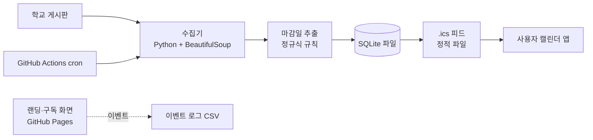

# 08. 기술 스택

| 제품 | 버전 | 최종 수정 | 관련 가설 |
|---|---|---|---|
| NotiCatch | 0.1 | 2026-11-26 | 전체 |

선택 원칙: ① 2주 내 첫 사용자 도달 ② 분석 이벤트 심기 쉬움 ③ Feature Flag 가능 ④ 팀이 이미 아는 것 ⑤ 무료/종량제 시작

## 1. 아키텍처 개요

## 2. 계층별 스택

| 계층 | 선택 | 선택 근거 (MVP 관점) | 검토한 대안 | 월 비용 (예상) | 리스크 / 전환 조건 |
|---|---|---|---|---|---|
| 프론트엔드 | 정적 HTML + JavaScript (GitHub Pages) | MS1까지 화면이 한 장이고 서버가 필요 없다 (원칙 ①④) | Next.js(Vercel): 로그인이 없는 MS2까지는 과함 | 0원 (공개 저장소 Pages 무료, 사이트 1GB·월 100GB 소프트 한도. 확인 URL: docs.github.com/en/pages/getting-started-with-github-pages/github-pages-limits, 2026-11-26) | 로그인이 필요한 구독자 100명 초과 시 Next.js 검토 |
| 백엔드 / API | 없음 (정적 `.ics` 파일 생성) | 로그인·실시간 API가 MVP 가설과 무관하다 (원칙 ①) | FastAPI: 구독별 동적 피드가 필요해지면 | 0원 | 구독별 개별 피드가 하루 요청 1,000회를 넘으면 FastAPI 도입 |
| 데이터 | SQLite 파일 | 사용자 100명 미만이라 파일 하나로 충분하다 (원칙 ④⑤) | PostgreSQL: 동시 쓰기 충돌이 없는 동안은 과함 | 0원 | 사용자 100명 초과 또는 동시 쓰기 충돌이 월 3회 이상이면 PostgreSQL |
| 인증 | 없음 (무작위 토큰 URL) | 처음 10명은 링크 하나로 충분, 이메일·이름을 수집하지 않아 개인정보 부담이 없다 (원칙 ①) | OAuth 로그인(Google): 토큰 분실 시 복구가 안 되는 문제가 쌓이면 | 0원 | 토큰 분실 문의가 월 3건을 넘거나 구독자 100명 초과 시 로그인 도입 |
| 호스팅 / 배포 | GitHub Pages + GitHub Actions | 이미 저장소와 CI를 쓰고 있다 (원칙 ④⑤) | Cloud Run: 동적 피드가 필요해질 때 | 0원 (Pages 무료, 위 URL 참조) | 정적 파일로 불가능한 요구(개별 피드)가 생기면 Cloud Run |
| 분석 · 실험 | 이벤트 로그 CSV + 스프레드시트 + 저장소의 Feature Flag 모듈 | 사용자 10~20명 단계에서 PostHog는 과하고 일일 집계는 Actions로 가능하다 (원칙 ②③) | PostHog: 구독자가 100명을 넘어 코호트·세션 분석이 필요해질 때 | 0원 | 질문이 스프레드시트로 답이 안 되는 경우가 3건 쌓이면 PostHog |
| CI/CD | GitHub Actions | 이미 pytest, ruff, 배포 워크플로우가 있다 (원칙 ④) | CircleCI: 새 도구를 배울 이유가 없다 | 0원 (공개 저장소의 표준 러너는 무료. 확인 URL: docs.github.com/en/billing/managing-billing-for-your-products/managing-billing-for-github-actions/about-billing-for-github-actions, 2026-11-26) | 저장소를 비공개로 바꾸면 월 포함 사용량(월 $12 상당)을 넘는지 확인 |
| 수집 | Python + requests + BeautifulSoup | 학교 게시판 대부분이 정적 HTML이고 이미 Python 코드가 있다 (원칙 ④) | Playwright: 렌더링이 필요한 게시판이 늘면 | 0원 | 자바스크립트 렌더링 게시판이 대상의 20%를 넘으면 Playwright |
| 마감일 추출 | 정규식 규칙 + 정답 코퍼스 테스트 | E1을 하루 안에 돌릴 수 있는 가장 싼 방법 (원칙 ①) | LLM 후보 추출 + 규칙 검증 | 0원 | E1 정확도가 90% 미만이면 LLM 보조 도입 (월 1만 원 이내일 때만) |
| 캘린더 | `.ics` 구독 피드 (RFC 5545) | 구글·애플 캘린더가 링크 구독을 지원하고 연동 승인이 필요 없다 (원칙 ①) | Google Calendar API: 승인과 OAuth가 필요 | 0원 | 즉시 반영을 원하는 사용자가 20%를 넘으면 API 연동 |

### ADR-1: 백엔드 서버 없이 정적 `.ics` 피드로 MS2까지 간다
- 상황: 1인, 주 15시간, 예산 월 1만 원 이하. 가설 H1·H2는 서버 없이 검증된다
- 결정: 수집·추출 결과를 Actions가 정적 `.ics` 파일로 만들어 Pages로 서빙. 구독별 개별 피드는 키워드별 파일로 대체
- 결과: 서버 운영·인증·DB 서버 비용과 학습이 사라진다. 대신 키워드 조합이 늘면 파일 수가 늘어난다
- 되돌릴 조건: 구독별 개별 피드 요청이 하루 1,000회를 넘거나 키워드 조합이 파일 100개를 넘을 때

## 3. 분석 · 실험 · Feature Flag

- 이벤트 수집: 이벤트 로그 CSV — `04-requirements.md` §3 이벤트 표 기준
- Feature Flag: 저장소의 `noticatch/flags.py` 모듈 — 노출 비율 10% / 대상 베타 그룹(첫 10명). 11주차 과제에서 만든 것을 재사용한다
- 일일 지표 수집: GitHub Actions `.github/workflows/metrics.yml`(미구현, MS1에서 추가) — 임계값 미달 시 Issue 자동 생성
- 코호트: 구독 주차 기준 D7 리텐션 (MS3부터)

## 4. 지금 하지 않을 것

| 하지 않을 것 | 다시 검토할 조건 |
|---|---|
| 자체 인증·회원가입 | 토큰 분실 문의가 월 3건 이상이거나 구독자 100명 초과 |
| 네이티브 앱 | `.ics` 구독으로 D30 유지율 30% 이상이 확인된 뒤 |
| 이메일·웹 푸시 알림 서버 | M5(리마인드 효과)가 통과하고 구독자 20명 이상 |
| 게시판 5곳 이상 확장 | M3(추출 정확도) 통과 후 |
| 사이트 로그인이 필요한 영역 수집 | 사이트 운영자 허락 또는 공식 API가 생길 때 |
| 마이크로서비스 / Kubernetes | MAU 10만 또는 팀 8명 이상 |
