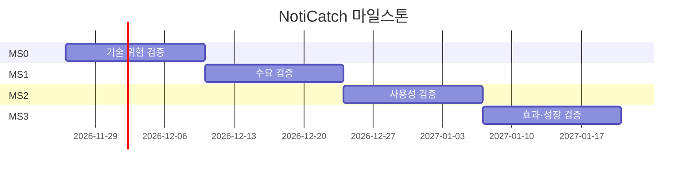

# 09. 마일스톤

| 제품 | 버전 | 최종 수정 | 관련 가설 |
|---|---|---|---|
| NotiCatch | 0.1 | 2026-11-26 | H1~H5 |

마일스톤은 기능 묶음이 아니라 **검증 단위**다. 종료 조건은 `05-metrics.md` 목표치를 인용한다.

## 1. 마일스톤 개요

| ID | 이름 | 기간 | 검증 가설 | 핵심 산출물 | 종료 조건 | No-Go 시 |
|---|---|---|---|---|---|---|
| MS0 | 기술 위험 검증 | W1~W2 (11-26~12-09) | H2 | 정답 코퍼스 15건 이상, 평가 스크립트 | M3 ≥ 90% | P1 |
| MS1 | 수요 검증 | W3~W4 (12-10~12-23) | H1 | 인터뷰 10건, 랜딩 페이지, Concierge `.ics` | M1 ≥ 40%, M2 ≥ 30% | P2 |
| MS2 | 사용성 검증 | W5~W6 (12-24~01-06) | H5 | 구독 화면 | M4 완료율 ≥ 50%, 중앙 ≤ 180초 | P3 |
| MS3 | 효과·성장 검증 | W7~W8 (01-07~01-20) | H3, H4 | 리마인드 자동화, 공유 링크 | M5 ≥ +10%p, M6 ≥ 0.3명 | P4 |

## 2. 마일스톤 상세

### MS0 — 기술 위험 검증 (W1~W2)
- 검증 가설: H2
- MVP 유형: Offline evaluation (공개 공지로 추출기만 평가, 사용자 없음)
- 산출물: 정답 코퍼스 15건 이상, 평가 스크립트, 결과 표
- 종료 조건: M3 ≥ 90% (공개 공지 15건 이상)
- Go: MS1 시작 — 인터뷰 모집, 랜딩 페이지 제작
- No-Go: M3 < 80% → `10-risks-and-pivot.md` P1. 80~90% 회색 지대 → 새 공지 20건 이상으로 1회 재측정
- 담당: 크롤러·추출 개발 (07)

### MS1 — 수요 검증 (W3~W4)
- 검증 가설: H1
- MVP 유형: Concierge (사람이 검수한 `.ics`를 처음 10명에게 전달)
- 산출물: 인터뷰 기록 10건, 랜딩 페이지, 이벤트 로그
- 종료 조건: M1 ≥ 40% (인터뷰 10명 중 4명 이상) 그리고 M2 ≥ 30% (방문 100회 이상)
- Go: MS2 시작 — 구독 화면 제작, 도메인 검수 중심에서 자동화로
- No-Go: M1 < 40% 또는 M2 < 15% → P2. M2가 15~30%이면 문구·채널을 바꿔 1회 재측정
- 담당: 제품·실험 설계, 도메인 검수 (07)

### MS2 — 사용성 검증 (W5~W6)
- 검증 가설: H5
- MVP 유형: Single-feature (구독 화면 하나)
- 산출물: 키워드 입력 → 링크 발급 화면, 관찰 기록 5건
- 종료 조건: M4 완료율 ≥ 50% 그리고 중앙 소요 ≤ 180초 (처음 보는 5명)
- Go: MS3 시작 — 리마인드 자동화와 공유 링크
- No-Go: 완료율 < 30% → P3. 30~50%는 문구만 바꿔 5명 추가 관찰
- 담당: 프런트·캘린더 연동, UX 피드백 (07)

### MS3 — 효과·성장 검증 (W7~W8)
- 검증 가설: H3, H4
- MVP 유형: Single-feature + 리마인드
- 산출물: D-3·D-1 자동 발송, 공유 링크, 14일 뒤 설문
- 종료 조건: M5 ≥ +10%p (20명) 그리고 M6 ≥ 0.3명 (구독자 20명 이상)
- Go: 구독자 100명 목표로 확장, 개발 인력 채용 검토
- No-Go: M5 < +5%p 이고 해지 30% 초과 → P4. M6 < 0.1명이 두 번 연속 → `10-risks-and-pivot.md` §4 Kill 조건 검토
- 담당: 제품·실험 설계, 크롤러·추출 개발 (07)

## 3. GitHub 매핑

| PRD 요소 | GitHub |
|---|---|
| MS0~MS3 | Milestones (due = 각 2주 종료일: 12-09, 12-23, 01-06, 01-20) |
| H# | Issue · 라벨 `hypothesis` |
| E# | Issue · 라벨 `experiment` · 템플릿 `.github/ISSUE_TEMPLATE/experiment.md` · Projects: Backlog → Running → Analysis → Shipped/Killed |
| MVP In 기능 | Issue · 라벨 `mvp` · 본문 `Validates: H#` |
| M# 지표 | `metrics.yml` 수집(MS1에서 추가) · 임계값 미달 시 자동 Issue |

## 4. 일정

